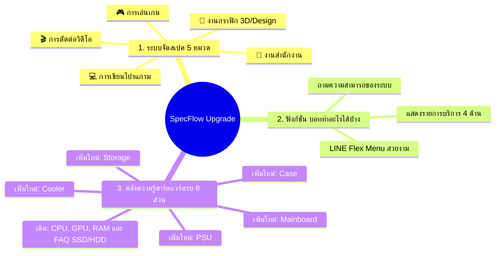
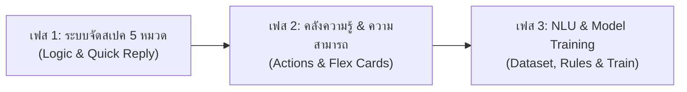

# SpecFlow: แผนการดำเนินงานและพัฒนาระบบฉบับสมบูรณ์ (Master Implementation Plan)

เอกสารฉบับนี้รวบรวมแผนงานทั้งหมดสำหรับการอัปเกรดระบบแชทบอท **SpecFlow** ครอบคลุมทั้ง:
1. **การปรับระบบจัดสเปคคอมพิวเตอร์เป็น 5 หมวดการใช้งาน** (เล่นเกม, กราฟิก, ตัดต่อวิดีโอ, เขียนโปรแกรม, สำนักงาน)
2. **ระบบตอบคำถามความสามารถของบอท** (ถามได้ว่า "บอททำอะไรได้บ้าง")
3. **ระบบคลังความรู้ฮาร์ดแวร์ครบวงจร 8 ชิ้นส่วน** (เพิ่ม Mainboard, Storage, PSU, Case, Cooler ให้ครบชุด จากเดิมที่มี CPU, GPU, RAM และ FAQ เปรียบเทียบ SSD/HDD)

---

## 🧭 สรุปภาพรวมการพัฒนา (System Scope Overview)



---

## ส่วนที่ 1: การปรับระบบจัดสเปคเป็น 5 หมวดการใช้งาน

### 1.1 ตารางสัดส่วนการจัดสรรงบประมาณ (Core Budget Allocation Formula)
งบประมาณหลัก 75% ของงบรวมจะกระจายตามลักษณะภาระงานจริงของฮาร์ดแวร์:

| หมวดการใช้งาน | GPU | CPU | RAM | Storage | วัตถุประสงค์และการทำงานของฮาร์ดแวร์ |
|---|:---:|:---:|:---:|:---:|---|
| **1. การเล่นเกม (Gaming)** | **40%** | 30% | 15% | 15% | ดันการ์ดจอสูงสุดเพื่อเฟรมเรตที่ลื่นไหล |
| **2. งานกราฟิก (Graphic/3D)** | **35%** | 30% | 20% | 15% | GPU ช่วยเรนเดอร์ 3D/Viewport + RAM รองรับเลเยอร์ขนาดใหญ่ |
| **3. การตัดต่อวิดีโอ (Video Editing)** | 25% | **35%** | **25%** | 15% | เน้น CPU หลาย Core สำหรับ Encode/Render + RAM พรีวิวไทม์ไลน์ |
| **4. การเขียนโปรแกรม (Programming)** | 15% | **40%** | **25%** | **20%** | CPU Compile ไว + RAM รองรับ Docker, IDEs, VMs + SSD โหลดโปรเจกต์ไว |
| **5. การใช้งานสำนักงาน (Office)** | 15% | 35% | 25% | 25% | คุ้มค่างานเอกสาร เน้น RAM/SSD; ใช้ iGPU เมื่องบต่ำกว่า 16,000 บาท |

> [!NOTE]
> หากงบประมาณต่ำกว่า 16,000 บาท ระบบจะตัดการ์ดจอแยกเป็น 0% และจัดสรรให้ CPU ที่มีชิปประมวลผลกราฟิกในตัว (Integrated GPU), RAM และ Storage อัตโนมัติ

### 1.2 รายละเอียดจุดที่ต้องแก้ไขในระบบจัดสเปค
1. **[`app/rasa/actions/templates/card_ask_usage.json`](../app/rasa/actions/templates/card_ask_usage.json)**:
   * เพิ่มปุ่ม Quick Reply เป็น 5 ปุ่ม: `เล่นเกม 🎮`, `งานกราฟิก 🎨`, `ตัดต่อวิดีโอ 🎬`, `เขียนโปรแกรม 💻`, `งานสำนักงาน 💼`
2. **[`app/services/recommendation/spec_recommender.py`](../app/services/recommendation/spec_recommender.py)**:
   * ในฟังก์ชัน `_determine_usage_type`: เพิ่มคลังคำค้นหา (Keyword List) แยกชัดเจน 5 หมวด (`gaming`, `graphic`, `video_editing`, `programming`, `office`)
   * ในฟังก์ชัน `get_recommendation`: ปรับเงื่อนไขตัวแปร `alloc` ตามตารางสัดส่วนงบประมาณด้านบน
3. **[`app/rasa/actions/actions.py`](../app/rasa/actions/actions.py)**:
   * ฟังก์ชัน `get_usage_type_db()`: ปรับการบันทึกสถิติประเภทการใช้งานลง SQLite ให้ตรงกับทั้ง 5 หมวด
   * `ActionAskUsage`: ปรับข้อความ Fallback ให้ยกตัวอย่างทั้ง 5 หมวด
4. **[`app/services/recommendation/upgrade_advisor.py`](../app/services/recommendation/upgrade_advisor.py)**:
   * เพิ่มเงื่อนไขตรวจสอบงานเขียนโปรแกรม หากผู้ใช้ระบุสเปคเดิมมี RAM $\le$ 8GB ให้แนะนำอัปเกรด RAM เป็น 16GB–32GB สำหรับรองรับ Docker และ IDEs
5. **[`tests/test_recommendation.py`](../tests/test_recommendation.py) และ [`tests/test_five_categories.py`](../tests/test_five_categories.py)**:
   * เพิ่มชุดทดสอบ Unit Test ครบทั้ง 5 หมวด ตรวจสอบความเข้ากันได้ของ Socket, RAM Type, Case Size และ PSU Wattage

---

## ส่วนที่ 2: ฟังก์ชันแนะนำความสามารถของบอท ("บอททำอะไรได้บ้าง")

เมื่อผู้ใช้พิมพ์ถาม เช่น *"บอททำอะไรได้บ้าง"*, *"ช่วยอะไรได้บ้าง"*, *"มีความสามารถอะไรบ้าง"* บอทจะสรุปรายการฟังก์ชันทั้งหมดของระบบให้ผู้ใช้ทราบ

### 2.1 เนื้อหาบริการหลัก 4 ด้านของ SpecFlow
1. **💻 แนะนำจัดสเปคคอมพิวเตอร์ประกอบใหม่**: คำนวณตามงบประมาณและความต้องการ 5 หมวด พร้อมเช็คความเข้ากันได้ของอุปกรณ์
2. **🔧 วิเคราะห์การอัปเกรดคอมพิวเตอร์และคอขวด**: ตรวจสเปคเดิม แนะนำชิ้นส่วนที่ควรเปลี่ยนเป็นอันดับแรก พร้อมแจ้งเตือน CPU/GPU Bottleneck
3. **📚 คลังความรู้และตอบข้อสงสัยฮาร์ดแวร์**: ให้ข้อมูลเชิงลึกเกี่ยวกับชิ้นส่วนคอมพิวเตอร์ครบทั้ง 8 ชิ้นส่วน
4. **⚡ แนะนำการเพิ่มความเร็วและแก้ปัญหาคอมช้า**: แนวทางปรับแต่งระบบ Windows และฮาร์ดแวร์ให้ทำงานได้ลื่นไหลขึ้น

### 2.2 ไฟล์และส่วนประกอบที่ต้องเพิ่ม
* **Intent ใน NLU**: `ask_bot_capabilities` (เพิ่มใน `nlu.yml` พร้อมประโยคตัวอย่าง ~20 ประโยค)
* **Domain & Rules**: ประกาศ intent ใน `domain.yml` และผูกกฎใน `rules.yml`
* **Card Template**: สร้างไฟล์ [`app/rasa/actions/templates/card_bot_capabilities.json`](../app/rasa/actions/templates/card_bot_capabilities.json) ในรูปแบบ LINE Flex Card แบบ Bubble รวมเมนูบริการพร้อมปุ่มกดเรียกใช้งาน

---

## ส่วนที่ 3: ระบบคลังความรู้ฮาร์ดแวร์ครบวงจร 8 ชิ้นส่วน

ขยายจาก FAQ เดิม 4 intents ให้ครอบคลุมฮาร์ดแวร์ 8 หมวด และคง FAQ เปรียบเทียบ SSD/HDD เป็นหัวข้อย่อยของ Storage รวม 9 hardware FAQ intents:

```
1. CPU       (ask_cpu_info)
2. GPU       (ask_gpu_info)
3. RAM       (ask_ram_info)
4. Mainboard (ask_mainboard_info)
5. Storage   (ask_storage_info)
   FAQ ย่อย: SSD เทียบกับ HDD (ask_ssd_hdd_diff)
6. PSU       (ask_psu_info)
7. Case      (ask_case_info)
8. Cooler    (ask_cooler_info)
```

### 3.1 สาระความรู้และ Intent สำหรับชิ้นส่วนที่เพิ่มใหม่

| ชิ้นส่วน | Intent ที่ต้องเพิ่ม | ประเด็นความรู้และคำอธิบายเชิงเทคนิค (Knowledge Scope) |
|---|---|---|
| **Mainboard (เมนบอร์ด)** | `ask_mainboard_info` | แผงวงจรหลักเชื่อมต่ออุปกรณ์, ความเข้ากันได้ของ Socket (AM4, AM5, LGA1700), ขนาดบอร์ด (ATX, Micro-ATX, Mini-ITX), และชนิดแรมที่รองรับ (DDR4 vs DDR5) |
| **Storage (สตอเรจ)** | `ask_storage_info` | แหล่งเก็บข้อมูลระยะยาว, แยก M.2 (รูปแบบอุปกรณ์) จาก SATA/PCIe NVMe, ความเร็วขึ้นกับรุ่นและการเชื่อมต่อ, การจัดไดรฟ์ OS/ไฟล์งาน และการสำรองข้อมูล |
| **PSU (พาวเวอร์ซัพพลาย)** | `ask_psu_info` | หัวใจจ่ายพลังงานให้คอมพิวเตอร์, การคำนวณวัตต์ (Wattage) ให้พอกับ CPU + GPU + Buffer, ระดับประสิทธิภาพพลังงาน 80 PLUS (Standard/White, Bronze, Gold), ระบบป้องกันแรงดัน/กระแสเกินและลัดวงจรตามรุ่น |
| **Case (เคสคอมพิวเตอร์)** | `ask_case_info` | กล่องบรรจุและปกป้องอุปกรณ์, การรองรับขนาดเมนบอร์ด (Form Factor Support), ทิศทางการไหลเวียนของลม (Airflow), พื้นที่รองรับความยาวการ์ดจอ และความสูงของพัดลม CPU |
| **Cooler (ชุดระบายความร้อน)** | `ask_cooler_info` | การควบคุมอุณหภูมิ CPU เพื่อป้องกัน Thermal Throttling, เปรียบเทียบชุดลม (Air Cooler) กับชุดน้ำปิด (AIO Liquid Cooler) โดยผลขึ้นกับรุ่น/ขนาด/การติดตั้ง และตรวจ Socket/พื้นที่เคส/ตำแหน่งหม้อน้ำ |

### 3.2 ไฟล์และส่วนประกอบที่ต้องแก้ไขในระบบ FAQ
1. **[`app/rasa/actions/actions.py`](../app/rasa/actions/actions.py)**:
   * ในคลาส `ActionFAQ` เพิ่มคีย์ใน `intent_map` ให้รองรับทั้ง 6 intent ใหม่: hardware FAQ 5 intents พร้อมข้อความอย่างละ 3 รูปแบบ และ `ask_bot_capabilities` พร้อมข้อความสรุปบริการทั้ง 4 ด้านสำหรับ CLI/เมื่อโหลดการ์ดไม่ได้
2. **สร้าง Card Template ใน `app/rasa/actions/templates/`**:
   * `card_faq_mainboard.json`
   * `card_faq_storage.json`
   * `card_faq_psu.json`
   * `card_faq_case.json`
   * `card_faq_cooler.json`
   * `card_bot_capabilities.json`

---

## ส่วนที่ 4: การตั้งค่า Rasa NLU, Domain, Rules และการเทรนโมเดล

เนื่องจากมีการเพิ่ม **6 Intent ใหม่** (`ask_bot_capabilities`, `ask_mainboard_info`, `ask_storage_info`, `ask_psu_info`, `ask_case_info`, `ask_cooler_info`) ระบบจึงต้องมีการอัปเดตไฟล์คอนฟิกของ Rasa และเทรนโมเดล NLU:

### 4.1 ไฟล์ที่ต้องอัปเดต
1. **[`app/rasa/data/nlu.yml`](../app/rasa/data/nlu.yml)**:
   * เพิ่มประโยคตัวอย่างสำหรับ 6 Intent ใหม่ (อย่างน้อย 15–20 ตัวอย่างต่อ intent)
   * เพิ่มตัวอย่างประโยคขอสเปคหมวดใหม่ เช่น *"จัดสเปคเขียนโปรแกรม"*, *"งบ 35000 ตัดต่อวิดีโอ"*
2. **[`app/rasa/domain.yml`](../app/rasa/domain.yml)**:
   * เพิ่มรายชื่อ 6 intent ใหม่ในส่วน `intents:`
3. **[`app/rasa/data/rules.yml`](../app/rasa/data/rules.yml)**:
   * เพิ่มกฎผูก Intent แต่ละตัวเข้ากับ `action_faq`:
     ```yaml
     - rule: Answer FAQ Mainboard
       steps:
       - intent: ask_mainboard_info
       - action: action_faq

     - rule: Answer Bot Capabilities
       steps:
       - intent: ask_bot_capabilities
       - action: action_faq
     ```
4. **เทรนโมเดลและอัปเดตโมเดลที่ใช้งาน**:
   * รันคำสั่งเทรนโมเดลใหม่:
     ```bash
     # รันจาก project root; เก็บโมเดลรุ่นใหม่แยกจาก final_models ของ baseline
     PYTHONPATH="$PWD/app/rasa" .venv-rasa-deploy/bin/rasa train \
       --config app/rasa/config.yml \
       --domain app/rasa/domain.yml \
       --data app/rasa/data/nlu.yml app/rasa/data/rules.yml app/rasa/data/stories.yml \
       --out models/five-categories/
     ```
   * อัปเดตตัวแปรชี้โมเดลใน [`run.py`](../run.py#L51) ให้เรียกใช้ artifact ใหม่หลังผ่านเกณฑ์ประเมิน พร้อมบันทึก path/SHA-256 และเก็บ path เดิมสำหรับ rollback

---

## ส่วนที่ 5: ลำดับขั้นตอนการทำงานจริง (Implementation Checklist)

สามารถแบ่งการทำงานออกเป็น 3 เฟสอย่างเป็นระบบ:



- [x] **เฟส 1: ปรับระบบจัดสเปค 5 หมวด (Backend/Actions; ยืนยัน NLU ในเฟส 3)**
  - [x] 1.1 แก้ Quick Reply ใน `card_ask_usage.json` (เพิ่มปุ่มครบ 5 หมวด)
  - [x] 1.2 แก้ไข `_determine_usage_type` และ `alloc` ใน `spec_recommender.py`
  - [x] 1.3 แก้ไข `get_usage_type_db` และ fallback ใน `actions.py`
  - [x] 1.4 ปรับแต่งการวิเคราะห์คอขวด RAM สำหรับเขียนโปรแกรมใน `upgrade_advisor.py`
  - [x] 1.5 เพิ่ม `tests/test_five_categories.py` และรันร่วมกับ regression เดิม `tests/test_recommendation.py` ผ่านทั้งหมด

- [x] **เฟส 2: สร้างคลังความรู้และบัตร Flex Card (Backend & Templates)**
  - [x] 2.1 สร้างไฟล์ Flex Card สำหรับ FAQ ใหม่ 5 ไฟล์ (`card_faq_mainboard.json`, `card_faq_storage.json`, `card_faq_psu.json`, `card_faq_case.json`, `card_faq_cooler.json`)
  - [x] 2.2 สร้างไฟล์ Flex Card สำหรับความสามารถบอท 1 ไฟล์ (`card_bot_capabilities.json`)
  - [x] 2.3 เพิ่มเนื้อหา Text 3 variations ต่อชิ้นส่วน และ mapping/ข้อความสำรอง `ask_bot_capabilities` ใน `ActionFAQ`

- [ ] **เฟส 3: อัปเดต Rasa NLU และฝึกฝนโมเดล (Conversational Model)**
  - [x] 3.1 เพิ่มตัวอย่างสำหรับ 6 intent ใหม่ พร้อม `inform_usage`, `build_pc` และ usage entity ของ 5 หมวด
  - [x] 3.2 ลงทะเบียน intents ใน `app/rasa/domain.yml`
  - [x] 3.3 เพิ่มกฎ rules ใน `app/rasa/data/rules.yml`
  - [ ] 3.4 ผ่านเกณฑ์ประเมินก่อนเปลี่ยนโมเดลใน `run.py`
    - [x] ตรวจข้อมูลและทำ 5-fold development evaluation ครบ
    - [x] เทรนโมเดลทดลองและตรวจ runtime ในเครื่อง
    - [ ] Development gate: Accuracy ≥91.25%, Macro F1 ≥91.36% (ปัจจุบัน 86.18% / 85.28%)
    - [ ] ประเมินชุดทดสอบใหม่หลัง development gate ผ่าน
    - [ ] เปลี่ยนโมเดลใช้งานเมื่อผ่านทุกเกณฑ์
  - [ ] 3.5 รันระบบทดสอบการสนทนาจริงผ่าน LINE Messaging API และ CLI

---

## ส่วนที่ 6: เกณฑ์การตรวจรับและความถูกต้อง (Acceptance Criteria)

1. **ทดสอบจัดสเปค**: ผู้ใช้พิมพ์หรือกดปุ่มทั้ง 5 หมวด สามารถคำนวณสเปคที่ตรงกับลักษณะงาน และชิ้นส่วนจำเป็นครบ โดยผ่านทุกกฎที่มีข้อมูลตรวจได้: CPU/บอร์ด Socket, RAM Type, Case Form Factor, Cooler Socket และ PSU ≥ CPU TDP + GPU Power + 100W; ไม่อ้างว่าครอบคลุม BIOS, ความยาว GPU, ความสูง Cooler หรือขนาดหม้อน้ำ
2. **ทดสอบถามความสามารถ**: ผู้ใช้พิมพ์ *"บอททำอะไรได้บ้าง"* ระบบแสดงการ์ดสรุปบริการ 4 ด้านชัดเจน
3. **ทดสอบความรู้ฮาร์ดแวร์**: ผู้ใช้สามารถถามข้อมูลได้ครบทั้ง 8 ชิ้นส่วน (CPU, GPU, RAM, Mainboard, Storage, PSU, Case, Cooler) พร้อม FAQ ย่อย SSD/HDD และได้รับข้อมูลที่ถูกต้องทั้งแบบ Text และ Flex Message บน LINE


---

## ส่วนที่ 7: ข้อตกลงและช่องว่างที่ปิดจากการตรวจแผน (2026-10-13)

### 7.1 นโยบายจัดหมวดและสถิติ
- ใช้ `app/services/recommendation/usage.py` เป็นแหล่งกลางสำหรับ 5 หมวด, label และสัดส่วนงบ ทั้ง recommender, upgrade advisor และ analytics
- ข้อความหลายงาน: เลือกงานเฉพาะทางที่กล่าวถึงก่อน; คำทั่วไป เช่น เรียน/เอกสาร ใช้เมื่อไม่พบงานเฉพาะทาง; ไม่พบ keyword ให้ default gaming ตามพฤติกรรมเดิม
- หลีกเลี่ยง keyword กว้าง เช่น `โปรแกรม` ที่อาจหมายถึง Word และตรวจขอบคำอังกฤษไม่ให้ `code` ตรงกับ `decode`
- คง label เดิม `เล่นเกม`, `กราฟิก`, `ออฟฟิศ` และเพิ่ม `ตัดต่อวิดีโอ`, `เขียนโปรแกรม` สำหรับข้อมูลใหม่
- ไม่ย้ายข้อมูล SQLite เก่าย้อนหลัง: `กราฟิก` ก่อนรุ่นนี้อาจรวมตัดต่อ/เขียนโปรแกรม และไม่มีข้อความต้นทางให้แยกได้ ต้องระบุข้อจำกัดนี้เมื่อนำสถิติข้ามรุ่นมาเทียบ

### 7.2 งบประมาณและขอบเขต compatibility
- ทุกสูตรรวมเป็น 100% ของ core budget 75%; ส่วนที่เหลือ 25% ใช้ Mainboard 40%, PSU 25%, Case 20%, Cooler 15% ของ secondary budget
- ต่ำกว่า 16,000 บาทใช้ iGPU ทุกหมวด: CPU 45%, RAM 25%, Storage 30%; ตั้งแต่ 16,000 บาทใช้ GPU แยกตามสูตรหมวด รวม Office
- หากเกินงบ ให้ลดราคาชิ้นส่วนที่ยังเข้ากันได้ก่อน โดยรักษา CPU/เมนบอร์ดที่เลือกไว้และลดหมวดที่เกินสัดส่วนมากที่สุดก่อน ไม่อ้างว่าเป็นการค้นหาสเปคทุกชุดที่เป็นไปได้
- ยังเกินงบไม่เกิน 10%: คืนคำแนะนำพร้อมเตือนจำนวนเงินที่เกินทั้ง Text และ Flex; เกิน 10%: คืน error ให้ปรับงบ/เงื่อนไข โดยไม่ส่งชุดอุปกรณ์เป็นคำแนะนำสำเร็จ
- CPU, Mainboard, RAM, Storage, PSU, Case, Cooler ต้องครบ; GPU ต้องมีเมื่อไม่ได้ใช้ iGPU หากไม่มีอุปกรณ์ที่เข้ากันได้ให้คืน error
- กฎ compatibility จำกัดตาม schema ปัจจุบัน ไม่รับรองระยะติดตั้ง GPU/Cooler, BIOS หรือหัวต่อไฟซึ่งยังไม่มีข้อมูล
- งานเขียนโปรแกรมที่ระบุ RAM ระบบ ≤8GB ให้แนะนำ 16GB–32GB สำหรับ IDEs/Docker/VMs และตรวจชนิด DDR/สล็อตก่อนซื้อ; ไม่เดารุ่นหรือราคา RAM เมื่อไม่มีข้อมูลเมนบอร์ด และไม่อ่าน VRAM เป็น RAM ระบบ

### 7.3 FAQ และปุ่มความสามารถ (งานเฟส 2)
- `ask_storage_info`: หน้าที่/ประเภท storage, NVMe/SATA และการแบ่งไดรฟ์; `ask_ssd_hdd_diff`: คำถามเปรียบเทียบ SSD กับ HDD โดยตรง ตรวจตัวอย่างเดิมและปรับ label ฝั่ง development ที่ทับซ้อนกัน
- ลงทะเบียน `ask_bot_capabilities` ใน ActionFAQ ด้วย โดยใช้ 1 ข้อความสรุปครบ 4 บริการเป็นขั้นต่ำ
- ปุ่มจัดสเปคส่ง `อยากจัดสเปคคอม` → build_pc; ปุ่มอัปเกรดส่ง `อยากอัปเกรดคอม` → upgrade_pc; ปุ่มความรู้ส่ง `CPU คืออะไร` → ask_cpu_info เป็นจุดเริ่ม; ปุ่มคอมช้าส่ง `คอมช้าทำอย่างไร` → optimize_performance
- ทดสอบ JSON, mapping, ช่องทาง LINE/CLI และกรณีโหลดการ์ดไม่ได้; ยืนยันข้อความปุ่มผ่าน NLU ในเฟส 3

### 7.4 NLU และ baseline ที่ใช้ประเมิน (งานเฟส 3)
- baseline ปัจจุบัน: development 800 ตัวอย่าง / 15 intents; SHA-256 `37b05d1f44de9153321b86e9a7eae1984e21fb0b12bbfac01a4e895c66077b7d`
- โมเดลเดิม: `final_models/run-20260825-001846/20260825-001851-woolen-billet.tar.gz`; ใช้หลักฐานใน `docs/final-readiness/master-final-values/` เป็น baseline ไม่ใช้รายงานเก่าที่ระบุ 264 ตัวอย่าง
- รุ่นใหม่มี 21 intents; เพิ่มอย่างน้อย 20 ตัวอย่างต่อ intent ใหม่ ตรวจข้อความซ้ำ/label ขัดกัน และเพิ่มตัวอย่าง usage entities สำหรับหมวดใหม่ด้วย
- เก็บผลประเมินและชุดข้อมูลเดิมเป็นหลักฐานของรุ่นเดิม ไม่เขียนทับ frozen holdout หรือใช้ประโยคทดสอบกลับไปฝึก; สร้างชุดประเมินรุ่นใหม่แยกไฟล์ มี intent ใหม่อย่างน้อย 10 ตัวอย่างต่อ intent และครอบคลุม intent เดิมทั้ง 15
- กำหนด split/seed, ตรวจ train-validation-test overlap, บันทึกจำนวนตัวอย่างและ hash ก่อนเทรน; ทำ development evaluation ก่อนเปิดผลชุดทดสอบใหม่
- เกณฑ์ development เบื้องต้น: OOF Accuracy ≥91.25% และ Macro F1 ≥91.36% อ้างอิง baseline; รายงานแยก 15 intents เดิมกับ 6 intents ใหม่ เพราะค่าโดยรวมข้ามจำนวนคลาสเปรียบเทียบโดยตรงไม่ได้
- เกณฑ์ intent ใหม่ในชุดประเมินรุ่นใหม่: Recall ราย intent ≥80%; รายงาน confusion ระหว่าง storage/SSD-HDD, capabilities/greet และ build_pc/inform_usage; หากไม่ผ่านให้คงโมเดลเดิมและปรับจาก development data
- ทดสอบเส้นทางพิมพ์/ปุ่มทั้ง 5 หมวด, build_pc/upgrade_pc form, FAQ แทรกระหว่างกรอกฟอร์มและกลับมาถาม slot เดิม; ป้องกันคำถาม FAQ ถูก from_text เก็บเป็น usage/current_specs
- เก็บผล entity extraction ของ usage/budget แยกจาก intent metrics และยืนยันค่าจริงของ slot ในการทดสอบสนทนา
- เปลี่ยน `run.py` หลังผ่าน gates เท่านั้น พร้อม path/hash โมเดลเดิมสำหรับ rollback; backend integration ไม่ใช้แทนหลักฐาน LINE live ต้องทดสอบ LINE จริงแยกต่างหาก

### 7.5 สถานะและผลตรวจเฟส 1
- เฟส 1 Backend/Actions และเฟส 2 FAQ/Templates เสร็จ; เฟส 3 เพิ่ม NLU/Rules และเทรนแล้ว แต่ development gate ยังไม่ผ่าน จึงยังไม่เปลี่ยนโมเดลใช้งาน
- ทดสอบ: `.venv-rasa-deploy/bin/python -B -m unittest discover -s tests -p 'test_five_categories.py' -v` — 14 tests ผ่าน รวม matrix 5 หมวด × 5 เงื่อนไขงบ/เผื่ออัปเกรด, ชิ้นส่วนหาย/ไม่เข้ากัน, งบเกิน, RAM, Quick Reply, analytics และข้อความ fallback
- Regression: `.venv-rasa-deploy/bin/python -B tests/test_recommendation.py` — 2 tests ผ่าน
- ทดสอบ analytics ผ่านฐานข้อมูลชั่วคราว ไม่แก้ข้อมูลผู้ใช้ใน `data/analytics.db`


### 7.6 สถานะและผลตรวจเฟส 2 (2026-10-13)
- เพิ่ม `ask_mainboard_info`, `ask_storage_info`, `ask_psu_info`, `ask_case_info`, `ask_cooler_info` ใน `ActionFAQ.intent_map` พร้อมข้อความและการ์ดที่จับคู่กัน 3 รูปแบบต่อ intent
- เพิ่ม `ask_bot_capabilities` พร้อมข้อความสรุป 4 บริการและ `card_bot_capabilities.json` แบบ Bubble มีปุ่มข้อความ 4 ปุ่มตามข้อ 7.3; ปุ่มความรู้เริ่มจาก CPU ตาม label ที่แสดง
- สร้าง JSON templates ใหม่ 6 ไฟล์; FAQ เดิมทั้ง 4 intents ยังคงพฤติกรรมเดิม
- `tests/test_faq_actions.py` — 8 tests ผ่าน ครอบคลุมการส่งการ์ด 28 รูปแบบ (เดิม 12 + ใหม่ 15 + capabilities 1), Text/CLI, mapping ปุ่ม, fallback เมื่อไฟล์หายหรือ JSON เสีย, unknown intent และการ serialize ด้วย LINE SDK ที่ติดตั้ง
- ตรวจความสอดคล้องข้อความกับการ์ดทุก variation และใช้ฐานข้อมูลในหน่วยความจำเมื่อ import actions เพื่อไม่เขียน analytics ของผู้ใช้
- แหล่งอ้างอิงเนื้อหาและข้อจำกัด: [FAQ content sources](faq_content_sources.md)
- ผลตรวจเฟส 2 ส่ง intent เข้า Action โดยตรง ไม่ใช่หลักฐานว่าโมเดลเดิมจำแนก intent ใหม่ได้; ดูผล NLU/form interruption ของเฟส 3 ในข้อ 7.7 ส่วน LINE live ยังไม่ตรวจ


### 7.7 สถานะและผลตรวจเฟส 3 (2026-10-13)
- เพิ่ม NLU/domain/rules ครบ 21 intents; candidate development 868 ตัวอย่าง และชุดทดสอบใหม่ 105 ตัวอย่างที่ยังไม่ใช้ประเมิน
- เก็บ baseline เดิม, รายการทำความสะอาดข้อมูล, hashes, 5-fold splits และ predictions ใน `docs/five-categories/`
- เทรนโมเดลทดลองสำเร็จ: `models/five-categories/candidate/candidate.tar.gz`
- OOF ข้อความดิบ Accuracy 86.18%, Macro F1 85.28%; ผ่าน LINE preprocessing Accuracy 84.91%, Macro F1 83.23%
- **Development gate ไม่ผ่าน** จึงยังไม่ประเมินชุดทดสอบใหม่และไม่เปลี่ยน `run.py`; โมเดลเดิมยังเป็นตัวใช้งาน
- Unit/regression ผ่าน 41 tests; runtime ในเครื่องผ่าน 90/90 cases (NLU smoke 30, FAQ/form interruption 50, build flows 10) ไม่ใช่ LINE live และไม่ใช่ holdout accuracy
- งานถัดไป: แก้ขอบเขต inform_budget/build_pc, inform_future_upgrade/upgrade_pc และเพิ่มความหลากหลาย FAQ จาก development errors แล้วประเมินซ้ำก่อนเปิดชุดทดสอบใหม่
- รายละเอียดและวิธีรันซ้ำ: [รายงานเฟส 3](five-categories/phase3-report.md)
- ระหว่าง regression พบเทสเดิมลบ analytics จริง; กู้จาก Git กลับมา 24 แถวแล้ว แต่ uncommitted changes ก่อนเริ่มงานยังไม่พบสำเนา แก้เทสให้ใช้ฐานข้อมูลชั่วคราวและยืนยัน hash ก่อน/หลังรันทดสอบใหม่ไม่เปลี่ยน รายละเอียดอยู่ในรายงานเฟส 3
